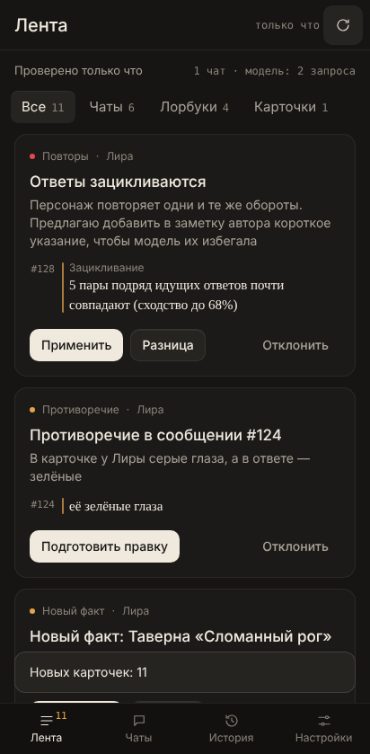
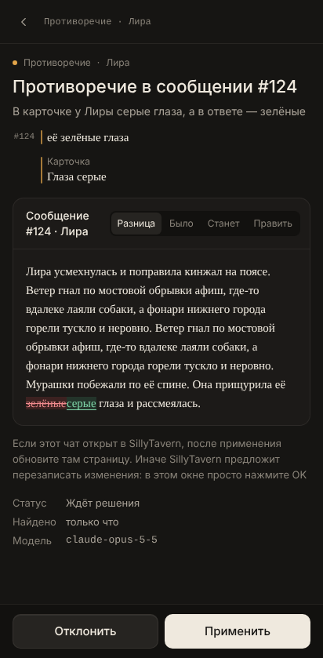
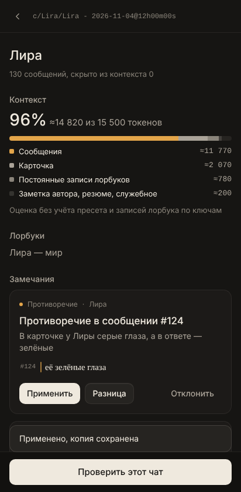

# Корректор — ИИ-ассистент для SillyTavern

<p align="center"></p>

**Новичкам:** [пошаговый гайд](docs/GUIDE.md) — телефон, компьютер (Windows, macOS, Linux), связь между ними, перевод и частые ошибки.

> **Бета-версия.** Приложение сейчас тестируется: что-то может работать не так. Перед каждым изменением делается резервная копия, а о проблемах можно написать в Issues на GitHub или в Telegram-канал.

Корректор — это приложение для телефона и плагин SillyTavern, который работает у него «под капотом». Пользуетесь вы приложением: иконка на главном экране, лента замечаний, кнопки «Применить» и «Откатить». Плагин живёт внутри SillyTavern и даёт приложению доступ к чатам, лорбукам и модели, отдельно открывать его не нужно.

Корректор сам читает ваши чаты, лорбуки и карточки, находит проблемы и показывает их карточками в приложении на телефоне. Вы смотрите разницу «было / станет» и нажимаете «Применить» или «Отклонить». Без вашего подтверждения ничего не меняется, перед каждым изменением делается резервная копия, любое изменение можно откатить.

Всё работает локально, без аккаунтов. Подходит любой ИИ, который подключён в SillyTavern: Claude, OpenAI, OpenRouter, Gemini, DeepSeek, Mistral, свой прокси или локальная модель через Text Completion. Запросы идут через подключение SillyTavern: ключ остаётся внутри него, Корректор ключи не видит и `secrets.json` не читает. Claude — наша рекомендация, а не требование.

<p>



</p>

## Что он находит

| Проблема | Что предлагает | Нужна модель |
| --- | --- | --- |
| Контекст переполнен, начало чата выпадает | Резюме старых сообщений и скрытие их из контекста | Да, сильная |
| Зацикливание и повторы фраз | Указание в заметке автора, по желанию — переписать последний ответ | Нет (переписывание — да) |
| Штампы вроде «мурашки по спине», «едва громче шёпота» | Указание в заметке автора, по желанию — переписать ответ | Нет (переписывание — да) |
| Противоречия карточке, лорбуку или прошлым событиям | Минимальная правка сообщения | Поиск — дешёвая, правка — сильная |
| Новые имена, места, отношения | Новая запись в лорбук или мемори-бук | Дешёвая |
| Дубли в лорбуке | Объединение записей | Нет (разный текст — сильная) |
| Плохие ключи: «он», пустые, сломанные регулярки, повторы | Очищенный список ключей, при нужде — новые ключи | Нет (подбор — дешёвая) |
| Раздутые карточки и постоянные записи | Сжатая версия без потери фактов | Сильная |
| Тяжёлые промпты пресета | Сжатая версия промпта в настройках и в файле пресета | Сильная |
| HTML, стили и блоки статуса в ответах | Правило Regex: разметка старых сообщений не уходит в модель, в чате всё остаётся | Нет |
| Рассуждения модели отправляются обратно в промпт | Выключить эту настройку | Нет |
| Записи лорбука повторяют карточку | Выключить запись (не удаляя) | Нет |
| Крупные записи, которые срабатывают по ключам | Сжатая версия записей | Сильная |
| Лорбук не влезает в бюджет, глобальные лорбуки, векторная память, длинная персона, закреплённые примеры | Совет, где и что поменять в SillyTavern | Нет |

Проверки без модели бесплатны и работают всегда. Модель зовётся для поиска фактов и противоречий (в фоне — только после 4 новых сообщений) и когда вы нажимаете «Подготовить правку».

## Куда уходят токены

На вкладке «Чаты» откройте чат: Корректор покажет, из чего состоит запрос к модели и сколько занимает каждая часть.

- Промпты пресета (Chat Completion) или системный промпт (Text Completion).
- Персона, карточка по полям, примеры диалогов, заметка персонажа.
- Лорбуки: постоянные записи и записи, которые сработали бы по ключам на последнем сообщении, с глубиной сканирования, вторичными ключами, цепочками, группами и бюджетом — по тем же правилам, что в SillyTavern. Это касается и мемори-бука: он тоже лорбук, подключённый к чату.
- Резюме Summarize, заметка автора, векторная память.
- История: текст сообщений отдельно от HTML и стилей, рассуждения модели, если они отправляются в промпт. Правила Regex, которые чистят промпт, учитываются.

Если всё сразу не влезает в контекст, Корректор показывает, сколько начала чата модель уже не видит.

**Точные цифры.** После каждого ответа расширение синхронизации забирает у SillyTavern разбор отправленного запроса: SillyTavern сам считает токены токенизатором модели. На экране чата это блок «Последний ответ: точно». В нём есть и вставки всех расширений по отдельности (Summarize, векторная память, Data Bank и CharMemory, заметки на глубине, скрипты /inject и другие) и сработавшие записи лорбука. Если какое-то расширение незаметно добавляет много токенов, в разделе «Токены» появится совет. Ниже точного блока остаётся оценка по файлам: что уйдёт, если отправить сейчас. Она приблизительная, без токенизатора модели.

## Расходы и «Сжать чат»

Вкладка «Ещё» → «Расходы»: сколько токенов ушло сегодня, за неделю и за 30 дней, отдельно на ролёвку и на проверки Корректора, по дням, моделям и чатам. Ролёвка считается после каждого ответа (это присылает расширение синхронизации), проверки Корректора — сами. Деньги показываются для моделей с известной ценой: цены OpenRouter берутся из его открытого списка, для остальных их можно вписать. Это оценка: точную сумму показывает провайдер.

Если каждый запрос в чате весит больше 30 000 токенов, чат попадает в «Дорогие чаты». Кнопка «Сжать чат» на экране чата собирает всё, что можно сократить: резюме старых сообщений, лишние записи лорбука, длинную карточку, тяжёлые промпты пресета. Отметьте нужное и нажмите «Применить выбранное»: где нужно, модель сначала напишет правку, перед каждым изменением сохраняется копия.

## Итоги сессии и здоровье карточек

На экране чата «Подвести итоги»: дешёвая модель коротко перескажет, что произошло с прошлого раза и на чём остановились, а Корректор добавит, что нашёл за это время. В чате при этом ничего не меняется.

«Ещё» → «Здоровье карточек»: оценка каждой карточки от 0 до 100 без модели — размер, пустые поля (первое сообщение, примеры диалога), лишняя разметка и ссылки, повторы, открытые замечания — и что поправить.

## Резервная копия, импорт и каталог

«Ещё» → «Резервная копия»: все данные пользователя SillyTavern одним ZIP-файлом — чаты, карточки, лорбуки, пресеты, настройки. Файл `secrets.json` с ключами в копию не попадает и при восстановлении не трогается. Миниатюры, векторные индексы и собственные копии SillyTavern пропускаются. Восстановление заменяет файлы с теми же именами и оставляет остальные. Перед ним Корректор сохраняет копию текущего состояния, её можно скачать там же.

«Импорт по ссылке»: карточка или лорбук с Chub, JanitorAI, RisuRealm и других сайтов, которые понимает импорт SillyTavern. Скачивает сам SillyTavern. В приложении для Android можно просто «Поделиться» ссылкой с Корректором.

«Каталог»: пресеты, лорбуки и карточки, которые авторы разрешили распространять. Список хранится в [`catalog/catalog.json`](catalog/README.md) и обновляется без обновления приложения. Установка ничего не перезаписывает: если имя занято, новый файл получит номер. То, что уже есть в таверне, помечено «✓ Установлено» — Корректор узнаёт это и по содержимому файла, даже под другим именем. «Удалить» убирает файл из таверны, а его копию оставляет в `korrektor/backups/catalog`.

В каталоге есть поиск и фильтры: по автору, по модели ИИ и по цензуре. У записей бывают обложка и скриншоты (нажмите на картинку — откроется на весь экран), значки моделей, «Без цензуры» / «С цензурой» и «+ регексы» у пресетов со своими регексами: таверна сама предложит их включить, когда пресет выберут.

«Предложить своё» в каталоге: выберите пресет, лорбук или карточку из своей таверны и нажмите «Отправить» — откроется «Поделиться» Android с уже прикреплённым файлом и текстом, остаётся выбрать Telegram и чат автора каталога. В пресет сами вкладываются включённые регексы таверны (лишний убирается нажатием), из пресета убираются пароли и адреса прокси.

Файл пресета, лорбука, карточки или регекса можно «Поделиться» с Корректором, например из Telegram: он предложит установить его в таверну, а автору каталога — сразу опубликовать (регексы внутри пресета видны, лишний можно убрать).

«Ведение каталога» (долгое нажатие на заголовок «Каталог»): публикация прямо из приложения. Один раз вставляется токен GitHub с правом менять только этот репозиторий; дальше выбираете файл из таверны или с телефона, вписываете название, автора и описание, добавляете до 4 картинок (приложение само их уменьшает), отмечаете модели и цензуру, к пресету — его регексы (общие регексы таверны или файлом), и нажимаете «Опубликовать». Опубликованную запись можно изменить: описание, теги, модели, картинки. Там же — убрать запись и указать, куда присылать предложения: `t.me/ник`, `@ник` или ссылку на сообщения канала. Подробно — в [`catalog/README.md`](catalog/README.md).

## Таверна на телефоне и на ПК

**Открыть таверну с ПК на телефоне.** На «Главной» приложения, в разделе «Таверна на ПК», впишите адрес компьютера: `http://IP-компьютера:8000` в той же Wi‑Fi или его адрес в Tailscale. Сверху появится переключатель «Таверна на телефоне / Таверна на ПК». Таверну на ПК запускают на самом компьютере, приложение её только показывает. На ПК в `config.yaml` нужно `listen: true` и одно из двух: адрес телефона в `whitelist` или `whitelistMode: false` и `basicAuthMode: true` с логином и паролем.

**Синхронизировать две таверны.** Если таверна стоит и на телефоне, и на ПК, Корректор переносит между ними чаты, групповые чаты, карточки, лорбуки, пресеты, фоны, аватарки персон и галереи персонажей, в обе стороны: «Ещё» → «Связь с ПК». Можно по кнопке или самому каждые 15 минут.

- Настройки (`settings.json`) и ключи (`secrets.json`) у каждой таверны свои и не переносятся.
- Ничего не удаляется: заменённые файлы сначала уходят в резервные копии.
- Если один и тот же чат менялся на обоих устройствах между синхронизациями, более новая версия остаётся чатом, а вторая появляется рядом отдельным чатом «…копия с телефона» или «…копия с ПК».
- Одинаковые файлы (например стандартные фоны обеих установок) не считаются конфликтом.

Корректор нужен в обеих тавернах. На ПК (Windows, macOS, Linux) он ставится так:

```bash
git clone https://github.com/yogurt5633-hub/st-app korrektor
cd korrektor
node scripts/install.mjs "путь/к/SillyTavern"
```

Установщик копирует плагин и расширение, включает серверные плагины и подсказывает, что поменять в `config.yaml`, чтобы телефон увидел эту таверну. Обновление: `git pull` и та же команда. Перед установкой закройте таверну. Если Windows не даёт записать файлы (`EIO`, `Access is denied`), установщик повторит запись и подскажет, что сделать. Пошагово, с настройкой сети: [гайд](docs/GUIDE.md).

## Скрытые замечания

Если трижды за месяц отклонить замечания одного вида, Корректор спросит, не перестать ли их показывать. Вернуть их можно в «Ещё» → «Скрытые замечания».

## Попросить Корректора

На экране чата есть поле для просьбы своими словами: «добавь в лорбук запись про таверну, куда мы пришли», «перепиши #124 без штампов», «скрой из контекста первые 40 сообщений», «что известно про Бориса?». Модель смотрит чат, лорбуки и карточку, при необходимости ищет нужное сама и готовит одну карточку правки: вы видите разницу, можете поправить текст и применить или отклонить. На вопрос она просто отвечает. Задачу «Просьбы к Корректору» по умолчанию делает сильная модель.

## CharMemory

Если стоит [CharMemory](https://github.com/bal-spec/sillytavern-character-memory), Корректор читает его воспоминания из Data Bank персонажа. Он сверяет с ними противоречия и не предлагает те же факты ещё раз. По умолчанию поиск новых фактов в таких чатах выключен: их собирает CharMemory. В настройках можно включить «Искать без повторов». Если воспоминания есть, а векторная память для файлов выключена (тогда модель их не получает), появится совет.

## Какие чаты проверять

Если чатов много, отметьте нужные звёздочкой на вкладке «Чаты» и выберите в настройках «Какие чаты: Отмеченные». Тогда Корректор сам проверяет только их. По умолчанию он проверяет несколько последних изменённых чатов. В ленте над карточками есть список: все чаты, только отмеченные или один конкретный чат.

## Как это устроено

```
Телефон: приложение Корректор (PWA)
        │  тот же адрес, что и SillyTavern
        ▼
SillyTavern ── плагин korrektor (plugins/korrektor)
        │        └─ расширение korrektor-sync во вкладке SillyTavern обновляет открытый чат после правки
        │        ├─ API: чаты, персонажи, лорбуки, резюме, заметки автора
        │        ├─ анализаторы и фоновая проверка
        │        ├─ применение правок, резервные копии, откат
        │        └─ запросы к модели через /api/backends/chat-completions/generate
        ▼
Модель (Claude, OpenRouter, свой прокси — что выбрано в SillyTavern)
```

Внутренний API SillyTavern не документирован, поэтому вся работа с файлами идёт через свой плагин, а запросы к модели — через штатный бэкенд генерации SillyTavern с вашей сессией.

## Установка на Android (Termux)

Нужен уже работающий SillyTavern в Termux (обычно в `~/SillyTavern`).

1. Скачайте Корректор и запустите установщик:

   ```bash
   pkg install git
   git clone https://github.com/yogurt5633-hub/st-app ~/korrektor-src
   bash ~/korrektor-src/scripts/install-termux.sh
   ```

   Установщик копирует плагин в `SillyTavern/plugins/korrektor`, ставит расширение синхронизации в `data/<пользователь>/extensions/korrektor-sync`, включает `enableServerPlugins: true` в `config.yaml` и создаёт ярлык для Termux:Widget. Если SillyTavern лежит в другой папке: `ST_DIR=/путь bash ~/korrektor-src/scripts/install-termux.sh`.

2. Перезапустите SillyTavern. В консоли появится строка `[korrektor] <версия> готов`.

3. Откройте в Chrome `http://127.0.0.1:8000/api/plugins/korrektor/app/` (если порт другой — подставьте свой).

4. Меню ⋮ → «Добавить на главный экран» или «Установить приложение». Иконка откроет Корректор как отдельное приложение.

Обновление: `git -C ~/korrektor-src pull` и снова `install-termux.sh`.

### Запуск SillyTavern одной кнопкой

Приложение в браузере не может само запустить процесс в Termux: Android этого не позволяет. Поэтому есть ярлык:

1. Установите приложение Termux:Widget (из того же источника, что и Termux: F-Droid или GitHub).
2. Добавьте на рабочий стол виджет Termux:Widget и выберите в нём «Корректор».

Нажатие запускает SillyTavern, если он не работает, и открывает Корректор. Если SillyTavern выключен, иконка Корректора всё равно откроется и подскажет, что сервер нужно запустить.

Для автозапуска после перезагрузки телефона можно поставить Termux:Boot и положить в `~/.termux/boot/` скрипт с `cd ~/SillyTavern && ./start.sh`.

### Уведомления

Если стоят приложение Termux:API и пакет `termux-api` (`pkg install termux-api`), фоновая проверка присылает уведомление Android, когда находит новое. Отключается в настройках.

## Приложение для Android

Приложение «Корректор» собирает всё в одном месте: внизу вкладки «Главная» (сводка, запуск таверны, обновления и настройки), «Таверна» (сам SillyTavern, в нём можно ролить), «Корректор» (замечания и инструменты) и «Сайты» (провайдеры ИИ). Оно само запускает SillyTavern в Termux, обновляет себя и Корректор и присылает уведомления о новых замечаниях. Ярлык Termux:Widget с ним не нужен.

### Установка

1. Нужен Termux из F-Droid или с GitHub (версия из Google Play устарела) и SillyTavern с Корректором, установленные по шагам выше.
2. Скачайте `korrektor.apk` со страницы [последнего выпуска](https://github.com/yogurt5633-hub/st-app/releases/latest) и установите. Android попросит разрешить установку из браузера.
3. Откройте приложение, вкладка «Ещё» → «Первая настройка»:
   - «Разрешить» — разрешение «Выполнять команды в среде Termux». Если окно с запросом не появилось: настройки приложения → Разрешения → Дополнительные разрешения;
   - скопируйте команду и выполните её в Termux (`allow-external-apps = true`), потом нажмите «Проверить»;
   - если SillyTavern в Termux ещё нет, кнопка «Установить SillyTavern» откроет Termux и поставит его вместе с Корректором (5–15 минут).

После этого приложение при открытии само запускает SillyTavern, если он выключен. Пока таверна запускается, на «Главной» видна последняя строка её вывода. Зависимости (`npm install`) ставятся только в первый раз и после обновления SillyTavern, поэтому обычный запуск быстрее, чем через `start.sh`. Таверна работает фоновой задачей Termux (в его уведомлении — «1 task»), открывать Termux не нужно. Кнопка «Журнал» показывает, что делало приложение, шаги Корректора в Termux и вывод таверны за последний запуск, без длинных списков моделей. Весь вывод — в `~/.korrektor-st.log` (`tail -f ~/.korrektor-st.log` в Termux).

**Команда запуска.** По умолчанию Корректор сам находит папку SillyTavern и запускает её. Если вы запускаете таверну своей командой (например `st`), впишите её в поле «Команда запуска в Termux» на «Главной». Подойдут и alias или функции из `~/.bashrc`. Команда вида `cd SillyTavern` понимается как «запустить таверну из этой папки». Если команда закончилась, а таверна так и не запустилась, приложение сразу скажет об этом. Там же меняется адрес, если SillyTavern работает не на `http://127.0.0.1:8000`.

### Главная, знакомство, виджет

На «Главной» сверху сводка: «Продолжить» последний чат (откроется сразу в таверне), сколько замечаний ждёт, сколько токенов ушло сегодня и работает ли ключ. При первом запуске (и один раз после обновления) приложение показывает знакомство: что оно умеет и как подключить Termux и SillyTavern.

Над таверной есть строка:

- «Обновить» перезагружает страницу таверны;
- «Перевод» включает встроенный переводчик SillyTavern (Chat Translation, по умолчанию бесплатный Google): новые ответы показываются на русском, а модель по-прежнему видит оригинал. По желанию ваши сообщения переводятся на английский перед отправкой. Переводчик выбирается: «Авто» (Google, если не отвечает — Bing, Яндекс, Lingva), Google, Bing, Яндекс, DeepL (с ключом в таверне), Lingva или дешёвая модель Корректора — она лучше держит ролевой стиль. Длинные ответы переводятся небольшими кусками, и если кусок вернулся на английском, Корректор переводит его заново по частям или следующим переводчиком; текст в блоках кода тоже переводится. Новые ответы переводятся, когда модель их дописала; думалка не переводится. Перевод появляется в сообщении по частям: готовые куски сразу встают на место оригинала (моделью — частями около 600 знаков, каждой части даётся всё сообщение для понимания имён и рода; выключается галочкой «Показывать перевод по частям»). Для перевода моделью можно выбрать отдельную модель — не ту, что пишет ответы в таверне: в окне перевода, в кнопке «Перевод» над таверной или в настройках Корректора («Для перевода сообщений»). «Старые сообщения» переводят то, что уже есть в чате: последние 20, 50 или весь чат, по одному сообщению, с повтором при ошибке. «Стоп», «Повторить пропущенные» и «Показать оригинал» — там же. Перевод, который вышел заметно короче оригинала (модель упёрлась в лимит или переводчик потерял конец), переводится заново по частям, а старые обрезанные переводы «Перевести» делает заново. Длинные ответы переводятся несколькими частями одновременно, модель переводит без долгих размышлений. Одно сообщение — кнопка с языком в меню сообщения (⋯). Переводу можно дать свой ключ (OpenRouter, OpenAI, Claude, Gemini, DeepSeek, Mistral или свой адрес) с кнопкой «Проверить и сохранить»: ключ хранится только в этой таверне (`korrektor/translate-key.json`), не попадает в копии и синхронизацию и странице не показывается. «Журнал» показывает, как шёл перевод, и копирует это одним текстом;
- «Фоны» — все фоны сеткой, смена одним нажатием для всех чатов или только для этого чата;
- «Аватар» — плавающее окно с картинкой персонажа, его можно двигать и растягивать. В галерее персонажа можно хранить сколько угодно картинок и менять аватарку одним нажатием, для этого чата или для всех чатов с персонажем;
- модель и пресет Chat Completion: выберите из списка с поиском, SillyTavern сохранит выбор сам. Модель и пресет можно скрыть в «Оформлении».

Фоны, аватар и «Перевести чат» работают и без приложения: они есть в меню расширений SillyTavern (волшебная палочка), их ставит расширение «Корректор». Там же тёмная или светлая тема и цвет акцента; вкладка «Корректор» перекрашивается вместе с приложением.

Виджет «Корректор» для рабочего стола показывает, работает ли таверна и сколько замечаний, и запускает её одной кнопкой.

**Таверна не перезагружается.** Пока таверна открыта, в шторке висит тихое уведомление «Таверна открыта»: с ним Android не выгружает приложение, когда вы открываете другие. Если Android всё же остановил страницу ради памяти, приложение тихо открывает её заново, а расширение «Корректор» возвращает тот же чат, место прокрутки и недописанное сообщение. На «Главной» → «Чтобы таверна не перезагружалась» — переключатель уведомления и кнопки, снимающие ограничения батареи для приложения и Termux.

«Сообщить о проблеме» на «Главной» собирает версии, состояние Termux и последние строки журнала в один текст, копирует его и предлагает отправить.

### Сайты провайдеров

Вкладка «Сайты» открывает сайты провайдеров ИИ прямо в приложении: войти, взять или сменить ключ, выбрать модель, пополнить баланс. Ключ потом вставляется в SillyTavern, в настройках подключения к API, и дальше хранится только там.

Сверху ряд названий для переключения. «В браузере» открывает текущую страницу в обычном браузере: это нужно, например, для входа через Google, который внутри приложений не работает. Список меняется на вкладке «Ещё» → «Сайты провайдеров». Сначала там OpenRouter, Элизиум и DDTokens; добавить можно любой сайт. Вкладку можно скрыть там же.

У страниц провайдеров нет доступа к приложению, к Termux и к файлам: это обычный просмотр сайта.

### Обновления

- **Приложение** проверяет новые выпуски на GitHub при открытии и каждые полчаса, пока открыто. Если вышла новая версия, над вкладками появляется плашка «Обновить». Кнопка «Обновить» на вкладке «Ещё» скачивает новую версию и открывает установку поверх старой; данные не теряются. Один раз Android попросит разрешить Корректору установку приложений.
- **Корректор** (плагин): приложение узнаёт о новой версии вместе с проверкой обновлений и показывает плашку. Кнопка «Обновить» ставит её и перезапускает таверну. Если включено «Обновлять Корректор сам», найденная новая версия ставится при следующем запуске таверны. Обычный запуск GitHub не ждёт: свежие файлы скачиваются, только когда есть что ставить, и не дольше 90 секунд.
- **SillyTavern** обновляется по кнопке (git pull и перезапуск) — только когда вы сами её нажмёте.

Фоновая проверка раз в час сообщает о новых замечаниях Корректора, если SillyTavern работает.

### Сборка своей копии

APK собирается на GitHub Actions при каждом изменении папки `android/` в `main`, и каждая сборка становится выпуском, откуда приложение берёт обновления. Новая версия ставится поверх старой, только если все сборки подписаны одним ключом. Ключ создаётся один раз командой в Termux:

```bash
bash ~/korrektor-src/scripts/setup-signing.sh
```

Скрипт ставит `gh` и `openssl`, просит один раз войти в GitHub, создаёт ключ и кладёт его в секреты репозитория (`KORREKTOR_KEYSTORE_BASE64` и `KORREKTOR_SIGNING_PASSWORD`). Копия остаётся в `~/.korrektor-signing`, в код ключ не попадает. Потом скрипт запускает сборку. Без ключа Actions собирает только тестовые APK (во вкладке Artifacts), и выпуски не публикуются.

## Модели

Корректор использует ИИ, к которому у вас есть ключ в SillyTavern. По умолчанию он берёт то же подключение и ту же модель, что выбраны в SillyTavern сейчас: ничего настраивать не нужно.

В настройках можно задать две модели:

- дешёвая — для фоновой проверки (поиск фактов, противоречий, подбор ключей);
- сильная — для резюме, исправлений, переписывания и сжатия.

Для каждой можно выбрать источник из списка Chat Completion SillyTavern (ключ к нему должен быть сохранён в SillyTavern) и модель — список моделей подтягивается у провайдера через SillyTavern. Можно указать, какая модель делает какую задачу, и лимит ответа.

Наша рекомендация — Claude: Haiku 5.5 или Sonnet 5.5 для фоновой проверки и Opus 5.5 (`claude-opus-5-5`) для сложных правок. Если в SillyTavern выбран Claude, а поля моделей пустые, эта пара включается сама. Кнопка «Использовать Claude» в настройках включает её и при другом подключении, если ключ Claude сохранён в SillyTavern.

Если в SillyTavern выбран Text Completion (KoboldCpp, llama.cpp, Ollama, Featherless, Mancer и другие), Корректор шлёт запросы туда же и собирает промпт по вашему instruct-шаблону. Небольшие локальные модели хуже справляются с поиском противоречий и ответами в формате JSON, для них лучше оставить проверки без модели и звать модель только для правок.

Температуру и похожие параметры Корректор не отправляет: для анализа хватает настроек провайдера по умолчанию, а новые модели Claude их и вовсе отклоняют. Для моделей OpenAI с рассуждением лимит передаётся как `max_completion_tokens`, как это делает сам SillyTavern.

## Как применяются правки

- Перед записью Корректор проверяет, что текст в файле тот же, что видел анализ. Если чат успел измениться, карточка помечается «Устарело», и ничего не пишется.
- Каждое изменение копирует исходные файлы в `data/<пользователь>/korrektor/backups/` (последние 100).
- «Откатить» возвращает только то, что поменял Корректор: новые сообщения, написанные после, остаются. Если вы сами поправили то же место, Корректор предложит восстановить файлы из копии целиком, и перед этим сохранит текущее состояние.
- Любую предложенную правку можно отредактировать вручную (кнопка «Править») перед применением.
- Правки настроек SillyTavern (пресет, Regex, рассуждения) записываются в `settings.json` и файл пресета. Открытая вкладка SillyTavern после этого перезагрузится сама, иначе она сохранила бы старые настройки поверх.
- Установщик ставит в SillyTavern маленькое расширение «Корректор: синхронизация». Когда Корректор меняет открытый чат, лорбук или карточку, расширение перезагружает их во вкладке SillyTavern, и следующее сохранение из SillyTavern правку не затирает. Без расширения обновите страницу SillyTavern вручную. Если SillyTavern всё же покажет окно о проверке целостности чата, нажмите OK: страница перезагрузится с правкой. Не вводите OVERWRITE, иначе правка затрётся.

Резюме по умолчанию сохраняется туда, где его читает встроенное расширение Summarize. В настройках можно выбрать заметку автора или лорбук чата. Сжатые сообщения скрываются из контекста, но остаются в чате; вернуть их можно откатом или командой `/unhide`.

## Доступ с другого устройства

По умолчанию SillyTavern в Termux слушает только сам телефон, и это самый безопасный вариант: Корректор открывается на этом же телефоне.

Чтобы открыть Корректор с компьютера или планшета, используйте локальную сеть или Tailscale: в `config.yaml` поставьте `listen: true`, добавьте адреса своих устройств в `whitelist` (для Tailscale — `100.64.0.0/10`) и включите `basicAuthMode: true` с логином и паролем. Не открывайте SillyTavern в интернет без пароля. Учтите, что по адресу `http://` с другого устройства браузер не даст установить приложение на главный экран, но страница работает как обычный сайт.

## API плагина

Все пути начинаются с `/api/plugins/korrektor`. Нужна сессия SillyTavern, для POST — заголовок `X-CSRF-Token` из `/csrf-token`.

| Метод и путь | Что делает |
| --- | --- |
| `GET /status` | Версия, подключение, модели, последняя проверка |
| `GET /models?source=…` | Модели провайдера (SillyTavern запрашивает их со своим ключом) |
| `GET /chats`, `GET /chat?id=…&messages=1` | Список чатов, чат с разбором контекста, заметкой автора и резюме |
| `POST /watch` | Отметить чат: `{ "chatId": "…", "watched": true }` |
| `GET /cards`, `GET /card?avatar=…` | Персонажи и поля карточки |
| `GET /worlds`, `GET /world?name=…` | Лорбуки и их записи |
| `POST /changes` | Предложить изменение: появится карточка, которая ждёт подтверждения |
| `GET /proposals?status=open\|closed` | Карточки |
| `POST /proposals/:id/apply\|reject\|revert\|prepare` | Действия с карточкой |
| `POST /scan` | Проверить сейчас (`{ "chatIds": [...] }` — только эти чаты) |
| `GET /jobs/:id` | Ход проверки или подготовки правки |
| `GET /backups`, `POST /backups/:id/restore` | Резервные копии |
| `GET /touched?since=…` | Что Корректор менял с этого момента (для расширения синхронизации) |
| `POST /actual` | Точный разбор последнего запроса от расширения синхронизации |
| `POST /ask` | Просьба своими словами: `{ "chatId": "…", "request": "…" }`, ответ и карточка правки приходят в задаче |
| `GET /usage?days=7`, `POST /usage/price` | Расходы по дням, моделям и чатам; цена модели за 1 млн токенов |
| `POST /connection-check` | Работает ли ключ (`{ "test": true }` — пробный запрос) |
| `GET /cards-health`, `GET /card-health?avatar=…` | Оценка карточек и советы |
| `POST /recap` | Итоги сессии: `{ "chatId": "…" }`, результат в задаче |
| `POST /translate` | Перевод одного сообщения моделью Корректора (задача «Перевод сообщений в чате», по умолчанию дешёвая модель; со своим ключом — напрямую к его сервису): `{ "text": "…", "lang": "ru" }` → `{ "text": "…", "cut": false, "model": "…", "via": "tavern" \| "key", "ms": 1234 }`; `cut: true` — ответ оборвался на лимите длины |
| `GET /translate/key` | Свой ключ для перевода: сервис, модель, включён ли, последние 4 знака ключа (сам ключ не отдаётся) |
| `POST /translate/key` | Сохранить: `{ provider, key?, model?, url?, kind?, on?, check? }`; `check: true` — сразу проверить (список моделей и перевод одной строки); `{ clear: true }` — удалить |
| `GET /translate/key/models` | Модели, доступные ключу |
| `GET /catalog/status`, `POST /catalog/uninstall` | Что из каталога уже есть в таверне; удалить установленное (с копией в резервных) |
| `GET /catalog/local?type=…`, `GET /catalog/export?type=…&file=…` | Пресеты, лорбуки или карточки этой таверны; файл для отправки (пресет без паролей и прокси) |
| `GET/POST /catalog/admin`, `POST /catalog/upload`, `POST /catalog/upload-image`, `POST /catalog/upload-regex`, `GET /catalog/regex`, `POST /catalog/publish`, `POST /catalog/edit`, `POST /catalog/remove`, `POST /catalog/submit-link` | Ведение каталога: токен GitHub (хранится только в таверне), загрузка файла, публикация, удаление записи, ссылка для предложений |
| `POST /mute` | Скрыть вид замечаний или вернуть: `{ "kind": "…", "muted": false }` |
| `GET /archive/info`, `GET /archive` | Размер и скачивание полной копии данных (ZIP) |
| `POST /archive/upload`, `POST /archive/restore` | Загрузить ZIP (тело запроса — файл), затем восстановить: `{ "upload": "…" }` |
| `GET /archive/safety`, `GET /archive/safety/:name` | Копии, сделанные перед восстановлением |
| `GET /catalog`, `POST /catalog/install` | Каталог и установка записи: `{ "id": "…" }` |

## Разработка

```bash
npm test        # юнит-тесты, без зависимостей
```

Плагин — обычные ES-модули без сборки и сторонних пакетов, приложение — HTML, CSS и JS без фреймворков. Проверено на SillyTavern 1.19.

Идея просьб своими словами пришла из [ST-Copilot](https://github.com/Supker/ST-Copilot) (MIT), идея брать точный разбор запроса у SillyTavern — из CharMemory; код этих проектов не копировался.

Оформление приложения сделано по правилам [unslop](https://github.com/heydamir/unslop) Дамира Соколовского (CC BY 4.0): одна тёплая нейтральная палитра, один акцент, без эмодзи, градиентов и свечения.
